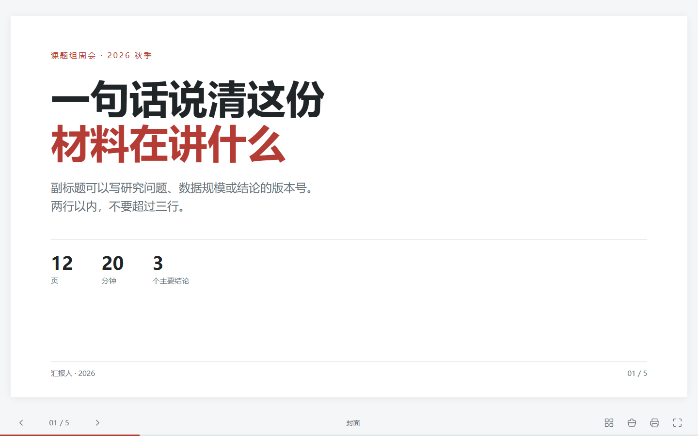
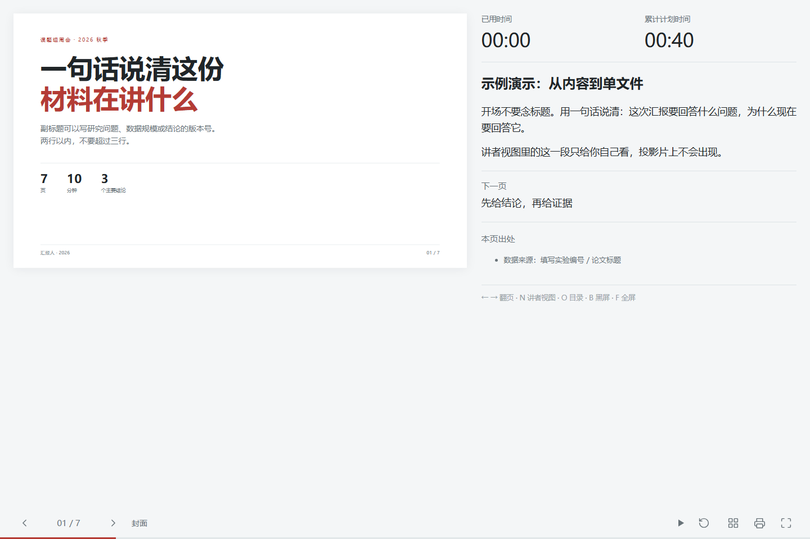

# html-deck

用写 Markdown 的心智写 HTML 演示：一份 `content.mjs`，一条命令，得到一个能离线打开、带演讲者视图、能打印成 PDF 的单文件网页。

**在线预览：<https://xiaohongrsx.github.io/html-deck/>**（打开后按 <kbd>N</kbd> 试试讲者视图）



同一个文件按 <kbd>N</kbd> 就是讲者视图 —— 左边预览，右边备注、计时、下一页、本页出处：



## 快速开始

需要 Node ≥ 22。自检和导出还需要本机装有 Chrome 或 Edge。

```bash
git clone https://github.com/xiaohongrsx/html-deck.git
cd html-deck
npm link                 # 全局多一个 html-deck 命令

html-deck new 组会汇报
cd 组会汇报
html-deck build --open
```

不想装也能直接看效果：[`examples/demo/index.html`](examples/demo/index.html)。

快捷键：<kbd>←</kbd> <kbd>→</kbd> 翻页，<kbd>F</kbd> 全屏，<kbd>N</kbd> 讲者视图，<kbd>O</kbd> 目录，<kbd>B</kbd> 黑屏，<kbd>Ctrl</kbd>+<kbd>P</kbd> 存 PDF。

## 它解决什么

- **不用管分辨率**：内容按 1280×720 写死，运行时整体缩放，投到任何屏幕都不跑版。
- **讲者视图不用另做一份**：同一个 HTML 加 `?presenter=1` 就是讲者界面。
- **交出去不会散**：图片、字体、图标全部内联进一个 HTML，拷到别人电脑上双击就能讲。
- **讲稿一起生成**：`script` / `notes` 导出成带时长表的 `讲稿.md`，打印出来照着念。
- **有验收标准**：`check` 用无头浏览器真的量每页有没有超出画布、两个窗口能不能同步。

## 命令

| 命令 | 作用 |
| --- | --- |
| `html-deck new <目录>` | 建一个 deck（`content.mjs` + `theme.css` + `images/`） |
| `html-deck build [目录]` | 构建 → `index.html` + `讲稿.md` |
| `html-deck dev [目录]` | 盯着文件改，存盘自动重建 |
| `html-deck check [目录]` | 自检版心溢出；`--sync` 验讲者视图；`--pdf` 验打印页数 |
| `html-deck export [目录]` | `--pdf` 出 PDF，`--png` 出每页 PNG（`--scale` 改像素密度） |

`build` / `check` / `export` 不带目录时用当前目录；`--open` 构建完直接开浏览器。

## 一个 deck 长什么样

```
我的汇报/
├─ content.mjs      内容：一页一个对象
├─ theme.css        配色与版式的覆盖（可选）
├─ images/          图片，构建时自动 base64 内联
├─ index.html       产物，不要手改
├─ 讲稿.md           产物：口播稿 + 时长表，可以直接打印
└─ export/          slides.pdf / slide-01.png …
```

### content.mjs

```js
export const meta = {title: "标题", subtitle: "副标题", prepared: "2026-11-09"};
export const stages = ["开场", "方法", "结果"];    // 顶部导轨的环节名

// 可选：讲述逻辑，生成到 讲稿.md 开头
export const logic = [
  {range: "1–2", gained: "说清要回答什么", open: "别人做到哪一步"},
];

export const slides = ({code, image}) => [
  {
    id: "cover",              // 锚点 #slide-cover，别用页码
    short: "封面",             // 底栏和讲者视图里的短标题
    kind: "cover",            // 可选：cover 会跳过大标题排版
    role: "main",             // 可选：main（默认）/ detail 主题案例 / reference 参考文献
    stage: null,              // 环节下标；null = 不显示导轨
    heading: "标题",           // 进目录、讲者视图
    seconds: 60,              // 计划秒数，用来算累计计划时间
    html: `<p class="lead">正文</p>`,
    notes: ["讲者视图里的第一段", "第二段"],
    sources: ["原论文 §3"],    // 讲者视图「本页出处」
    footer: "页脚左侧文字",
    script: ["口播稿第一段", "第二段"],   // 可选：整段写进 讲稿.md
    transition: "下一页的过渡句",          // 可选：讲稿里加粗
  },
];
```

`role` 只影响讲稿和目录：`reference` 页会在目录里单独起一节「参考文献」，讲稿开头会写「含 N 页主线、M 页主题案例」；`detail` 会在时长表里标成「案例」。不写就是主线，老 deck 不用改。

`slides` 也可以直接写成数组（`export const slides = [...]`），需要图片内联时才用函数形式。

两个助手：

```js
code(`const a = 1;  // 自动上色`)        // 或 code(["第一行", "第二行"])
image("loss.png")                        // 读 images/loss.png → data:image/png;base64,…
```

> `content.mjs` 里写 HTML 用的是模板字符串，正文里如果要用反引号或 `${`，记得转义（`\``、`\${`）。

### 现成组件

`.lead` `.bullets` `.cards.c2/.c3` `.table` `.split` `.stack` `.code` `.callout` `.kpis` `.steps`
`.figure`（配 `zoomable` 可点开放大）`.windows`+`.win`+`.wire`（双窗口示意）`.fit-window` `.sheets` `.tag` `.chip`

配色改 `theme.css` 顶部的变量即可。

## 讲稿

`build` 除了 `index.html`，还会生成 `讲稿.md` —— 一份可以直接打印、照着讲的口播稿。

- 开头是**讲述逻辑**表（来自 `logic`）：哪几页负责得到什么、还留着什么没解决
- 然后是**时长一览**表：每页计划时长 + 累计到这一页是多少分钟；有 `role` 时多一列「类型」
- 每页一节：页号、标题、时间区间（`02:20 – 04:20 · 计划 02:00`）
- 正文优先用 `script`（口播稿）；这一页没写 `script` 就导出 `notes`
- 有 `transition` 会加粗一句「过渡：…」，有 `sources` 会列「来源：…」
- 写了 `script` 时，`notes` 作为 `> 备注：…` 附在正文下面（讲者视图里看到的仍然是 `notes`）

```js
{
  script: ["今天讲三件事。", "第一件：为什么现在要解决它。"],  // 可选，几段都行
  transition: "问题说清楚了，下面看别人做到哪一步。",            // 可选
  notes: ["停两秒再翻页"],                                       // 讲者视图里的短备注
}
```

示例的产物：[`examples/demo/讲稿.md`](examples/demo/讲稿.md)。

## 自检

```bash
html-deck check              # 每页溢出 + 距底边余量
html-deck check --shots      # 顺便截图到 .preview/
html-deck check --sync       # 真开两个窗口验证 postMessage 双向同步
html-deck check --pdf        # 打印 PDF 数页数
```

「底边余量」是负数就说明内容压到页脚了。改内容或换组件，别靠肉眼估。

## 讲者视图

构建产物里按 <kbd>N</kbd>：

- 弹出一个新窗口，同一个文件加 `?presenter=1&session=…`
- 左边是幻灯片预览，右边是备注、已用时间、累计计划时间、下一页标题、本页出处
- 主窗口是**唯一真相源**：讲者窗口点「下一页」只是发个意图，页码由主窗口广播回来
- 把讲者窗口拖到笔记本屏，主窗口 <kbd>F</kbd> 全屏投出去

浏览器第一次会问是否允许弹窗，允许即可。

## 当成库用

```js
import {buildDeck, checkDeck, exportDeck, scaffold} from "html-deck";

await scaffold("新报告", {title: "组会报告"});
await buildDeck({dir: "新报告"});
const result = await checkDeck({dir: "新报告", sync: true});
await exportDeck({dir: "新报告", formats: ["pdf", "png"], scale: 2});
```

## 示例

[`examples/demo/`](examples/demo/) 是 7 页的完整例子：封面、要点、方法（表格 + 代码）、结果（图片）、主题案例、下一步、延伸阅读。最后两页演示 `role` 分层，讲稿里的类型列和「参考文献」分组就是它们带出来的。

```bash
npm run demo          # 重新构建并打开
npm run demo:check    # 版心 + 讲者视图自检
```

产物 `examples/demo/index.html` 也提交在仓库里，双击即可打开。

## 空间占用

| 东西 | 大小 |
| --- | --- |
| 仓库本身（工具 + 模板 + 示例 + 文档） | **不到 100 KB**，没有 `node_modules` |
| 一次 `check` / `export` 的临时浏览器配置 | 运行中约 7 MB，跑完立刻删 |
| 产物 `index.html` | 几十 KB；图片全部内联后会到几 MB |
| 导出 PNG | 每页 1–3 MB |

`check` 和 `export` **不下载也不复制 Chrome**：直接用你机器上已经装好的浏览器，只是给它一个空的临时配置目录。

## 1280×720 和 2560×1440

版式坐标永远是 **1280×720** —— 所有页面的排版、字号、留白都按这个写死，`check` 量的也是这个。

导出 PNG 时默认按 2 倍像素密度渲染**同一张画布**，得到 2560×1440：比例一样，只是每个点用 4 个像素画，贴进 Word、PPT 或印刷不糊。要原尺寸用 `--scale 1`。PDF 是矢量的，没有这个问题。

## 目录结构

```
cli.mjs            命令入口
index.mjs          库入口
src/build.mjs      读内容 → 校验 → 内联 → 单文件
src/build-lib.mjs  转义 + 零依赖语法高亮
src/player.js      运行时：缩放 / 翻页 / 讲者视图 / 计时 / 目录 / 放大 / 黑屏
src/deck.css       版式组件 + body.presenter + @media print
src/check.mjs      版心 / 同步 / PDF 自检
src/export.mjs     PDF 与 PNG 导出
src/chrome.mjs     无头浏览器与 CDP 客户端（零依赖）
src/scaffold.mjs   脚手架
templates/         new 用的模板
examples/demo/     7 页示例（含产物）
docs/              设计说明与截图
```

没有 npm 依赖：构建是字符串拼接，自检走 Chrome DevTools Protocol。

## 坑

- 讲者视图依赖 `window.open`，浏览器拦弹窗就开不出来（会弹提示）。
- 单文件体积会到几 MB：字体和图片都是 base64。拿体积换「一定打得开」。
- 构建会拒绝缺 `id` / `heading` / `notes`、`seconds` 非正整数的页，报错里会写清第几页。
- `index.html` 和 `讲稿.md` 是产物，别手改 —— 改 `content.mjs`。

## License

[MIT](LICENSE)
